<picture>
  <source media="(prefers-color-scheme: dark)" srcset="./assets/banner-dark.svg">
  <source media="(prefers-color-scheme: light)" srcset="./assets/banner-light.svg">
  
</picture>

  <a href="https://jchambard.dev"><b>jchambard.dev</b></a> ·
  <a href="https://www.linkedin.com/in/john-chambard/">LinkedIn</a> ·
  <a href="mailto:johnchambard07@gmail.com">Email</a>

I'm a computer science student at Purdue (B.S. May 2028) who likes building things that work end to end: firmware talking to Python pipelines, LLM systems running on my own GPU, and products people actually use. Previously a software engineering intern at Phillips 66 and NETSYNC.

**Looking for Summer 2027 internships** in software engineering, AI/ML, and embedded systems.

## Selected work

| Project | What it is |
|---|---|
| **[HearLink](https://github.com/jchambard/HearLink-Project)** ESP32-S3 · ESP-IDF · C · Python · TensorFlow | Wearable spatial-sound awareness for Deaf and hard-of-hearing users. A four-mic collar streams audio over UDP to a host that beamforms, classifies sounds with YAMNet, and drives directional haptics and a head-mounted compass. Built at StarkHacks; I wrote all of the firmware and software. |
| **[Morph](https://github.com/jchambard/Morph-Startup-Project)** Python · FastAPI · TypeScript · LLMs | Goal-first personal software. An LLM pipeline turns what you're trying to accomplish into generated, working widgets, with Anthropic and fully local Ollama backends. |
| **[jchambard.dev](https://jchambard.dev)** React · Three.js · Docker · Cloudflare Tunnel | My portfolio: a procedurally generated mechanical watch movement that disassembles as you scroll, self-hosted on my own Linux box. |
| **[JackScript](https://github.com/jchambard/JackScript)** Java | A scripting language implemented from lexer through runtime, mixing ideas from Python and Java. |
| **Agentic OS** (private) Docker · Ollama · Postgres/pgvector · FastAPI | Self-hosted, GPU-accelerated assistant with RAG over my documents and connectors for calendar, fitness, and reminders. |

## Experience

- **Phillips 66** — Software Engineering Intern · 2026
- **NETSYNC** — Software Engineer Intern · 2025
- **RTX-sponsored research, Purdue** — RF ground-asset optimization · 2026–27
- **STACK at Purdue** — Project Manager
- **Tutelum** — Co-founder · MVP for policy-governed payments by autonomous AI agents (x402, MCP)

Most comfortable in Python, TypeScript, Go, C, and Java · Docker, Azure, AWS · ESP-IDF
